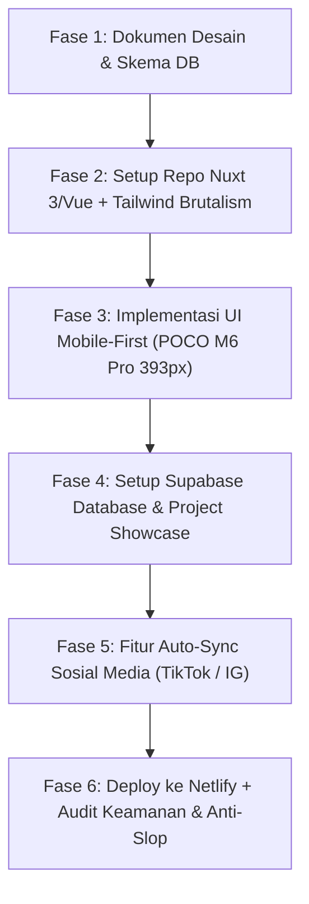

# Architecture & Project Plan: Amru Portfolio

Dokumen ini mendefinisikan arsitektur teknis, desain sistem, dan tahapan implementasi website portofolio Amru.

---

## 1. Spesifikasi Perangkat Target (Mobile-First Focus)
- **Perangkat Acuan**: POCO M6 Pro 4G
- **Resolusi Fisik**: 1080 x 2400 pixels (~395 ppi, 20:9 ratio, 120Hz AMOLED)
- **Viewport CSS (Logical Pixels)**: **393 x 873 px** (standar Android modern 20:9)
- **Touch Target Minimum**: 44 x 44 px untuk kenyamanan navigasi satu tangan (thumb zone).

---

## 2. Tech Stack & Arsitektur

### Frontend:
- **Framework**: **Nuxt 3 (Vue 3)** atau **Vite + Vue 3 (SPA)**
  - *Kenapa Nuxt/Vue?* Sesuai request "Anti React/Next.js", reaktif, performa sangat kencang, dan ramah SEO/Meta-tags.
- **Styling**: **Tailwind CSS** dengan konfigurasi tema **Neo-Brutalism**:
  - High-contrast border (`border-2 border-black` / `dark:border-white`)
  - Hard drop-shadows tanpa blur (`shadow-[4px_4px_0px_0px_#000]`)
  - Tipografi tegas (*brutalist mono & heavy grotesk sans*)
- **Animasi**: **GSAP (GreenSock)** + **ScrollTrigger** untuk micro-interactions 120Hz yang reponsif dan bebas jank.

### Database & Storage:
- **Supabase (PostgreSQL)**:
  - Tabel `projects`: Daftar website/proyek buatan Amru (judul, deskripsi, tech stack, screenshot, live link).
  - Tabel `social_posts`: Konten hasil sinkronisasi TikTok / Instagram yang dipilih tampil sebagai portofolio konten.
  - Supabase Storage: Media assets & screenshots.

### Backend & Integrasi Konten:
- **Pilihan Arsitektur**:
  - **Opsi A (Ramping & Cepat)**: **Nuxt 3 Server Routes (`/server/api/...`)** + Supabase Client. Sangat hemat resource, tidak perlu host backend terpisah.
  - **Opsi B (Eksperimen Golang)**: **Golang API Service (Gin / Fiber)** sebagai microservice sinkronisasi & web scraper/webhook handler jika ingin servis independen.
- **Auto-Sync TikTok / Instagram**:
  - Instagram Graph API / TikTok API atau Webhook / RSS Fetcher + manual toggle flag `is_featured` di database Supabase agar Amru bebas memilih konten mana yang layak dipajang.

### Hosting & Deployment:
- **Pilihan Hosting**: **Netlify** atau **Vercel** (direkomendasikan Netlify untuk Nuxt Serverless API + CDN gratis dan custom domain mudah).

---

## 3. Roadmap Tahapan Eksekusi

1. **Fase 1 (Tahap Saat Ini)**: Finalisasi dokumen arsitektur dan skema database.
2. **Fase 2**: Setup dasar project Vue 3 / Nuxt 3 + konfigurasi Tailwind Neo-Brutalism.
3. **Fase 3**: Layout & komponen mobile-first (Hero, Bio, Project Showcase, Interactive Brutalist Dock/Navbar).
4. **Fase 4**: Setup database Supabase (`projects`, `social_feeds`) dan integrasi data fetch.
5. **Fase 5**: Modul sync TikTok / IG (webhook/API handler).
6. **Fase 6**: Deploy ke Netlify/Hosting pilihan & audit akhir (keamanan, token, zero dead code).

